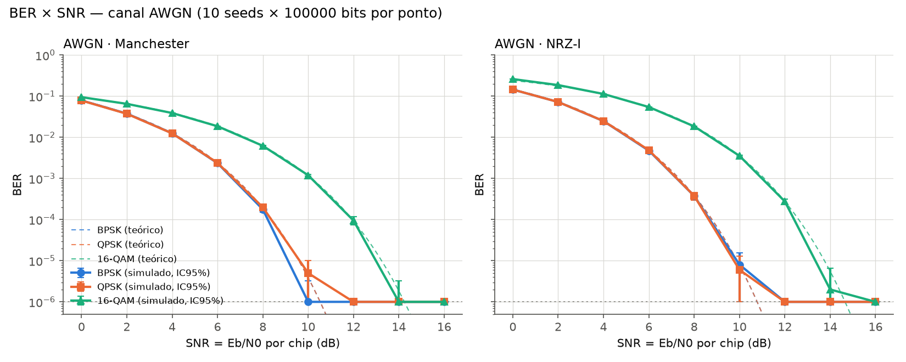
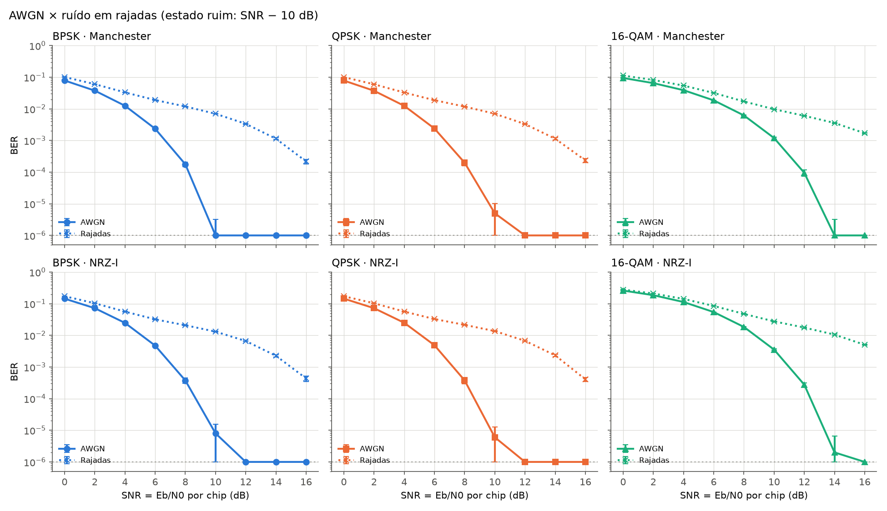

# projeto-redes-modulacao

Simulador de transmissão digital (Redes de Computadores — UNISINOS, Trabalho do GB).
Avalia o impacto de **codificação de linha** e **modulação digital** na **taxa de erro de bits (BER)**
e na **eficiência espectral**, em canal AWGN e em canal com **ruído em rajadas**.

## Instalação e execução

```bash
python3 -m venv venv
source venv/bin/activate
pip install -r requirements.txt

python main.py tudo          # roda tudo (~1 min) e regera todos os resultados
```

Comandos individuais:

| Comando | O que faz | Saída |
|---|---|---|
| `python main.py consistencia` | teste de consistência (canal ideal e SNR = 40 dB) | `results/consistencia.txt` |
| `python main.py demo` | mensagem ASCII pelo sistema, com bits/letras incorretos | terminal |
| `python main.py varredura` | varredura completa de BER (1080 ensaios) | `results/raw/results.csv`, `results/raw/config.txt` |
| `python main.py mensagem` | recuperação da mensagem nos dois canais | `results/raw/mensagem.csv` |
| `python main.py graficos` | gráficos e tabela a partir dos CSVs brutos | `results/figures/*.png`, `results/tabela_compromisso.md` |
| `python -m pytest` | testes automatizados | — |

## Arquitetura

```
mensagem ASCII / bits aleatórios ──► codificação de linha ──► modulação ──► CANAL ──► demodulação
   (message.py)                       (line_coding.py)        (modulation.py) (channel.py)  (modulation.py)
                                                                                              │
  métricas: BER, posições dos erros, eficiência ◄── reconstrução do texto ◄── decodificação de linha
   (metrics.py)                                     (message.py)              (line_coding.py)
```

| Arquivo | Responsabilidade |
|---|---|
| `src/message.py` | texto ASCII ↔ bits (8 bits/caractere); bits aleatórios com seed |
| `src/line_coding.py` | Manchester (2 chips/bit) e NRZ-I (1 chip/bit) |
| `src/modulation.py` | BPSK, QPSK e 16-QAM com mapeamento Gray, energia média 1, decisão abrupta |
| `src/channel.py` | AWGN e canal com rajadas (cadeia de Markov de 2 estados) |
| `src/metrics.py` | BER, posições dos bits incorretos, eficiência espectral nominal |
| `src/simulator.py` | cadeia ponta a ponta (`transmitir`) |
| `src/theory.py` | BER teórica em AWGN (comparação com a simulação) |
| `src/experiments.py` | varredura, recuperação da mensagem, teste de consistência, demonstração |
| `src/plots.py` | agregação (média, IC95%), gráficos e tabela de compromisso |
| `src/config.py` | **todos os parâmetros do experimento** |
| `main.py` | linha de comando |

## Parâmetros do experimento (`src/config.py`)

| Parâmetro | Valor |
|---|---|
| Modulações | BPSK (1 bit/símb.), QPSK (2), 16-QAM (4, ordem superior) |
| Codificações de linha | Manchester, NRZ-I |
| Canais | AWGN; rajadas (P(bom→ruim) = 0,01, P(ruim→bom) = 0,1, estado ruim = SNR − 10 dB) |
| SNR (Eb/N0 por chip) | 0, 2, 4, 6, 8, 10, 12, 14, 16 dB (9 valores) |
| Bits de informação por ensaio | 100.000 |
| Repetições (seeds) | 10 (seeds 1 a 10) → 1.000.000 de bits por ponto |
| Total de ensaios | 2 canais × 3 modulações × 2 codificações × 9 SNRs × 10 seeds = **1080** |
| Mensagem de demonstração | `"Redes de Computadores - UNISINOS"` (256 bits) |

**Definição de SNR.** A SNR é Eb/N0 **por chip transmitido** (energia de cada bit que entra no
modulador). Os símbolos têm energia média 1, então Es/N0 = Eb/N0 · bits_por_símbolo e o ruído tem
variância 1/(2·Es/N0) por eixo. Como o Manchester envia 2 chips por bit de informação, a energia
gasta **por bit de informação** é o dobro (+3 dB) da do NRZ-I com a mesma SNR por chip.

**Comparação justa.** Para cada seed, os mesmos bits são usados em todas as modulações,
codificações, canais e SNRs. O ruído usa a seed `seed + 100000`. No canal com rajadas, o ruído base
é o mesmo do AWGN (mesma seed); a única diferença é que ele é amplificado no estado ruim.

**Tamanho da amostra.** Com 10⁶ bits por ponto, uma BER de 10⁻⁴ gera ~100 erros (erro relativo
≈ 1/√100 = 10%). A menor BER mensurável é ~10⁻⁶; pontos sem nenhum erro aparecem no gráfico
sobre a linha pontilhada do piso (10⁻⁶), e isso significa "BER < 10⁻⁶", não "BER = 10⁻⁶".

**Variabilidade.** As barras de erro são o intervalo de confiança de 95% da BER média entre as
10 seeds (t de Student, 9 graus de liberdade). Os valores por seed estão em
`results/raw/results.csv` e o resumo (média, desvio, IC95%, mín., máx.) em `results/raw/ber_resumo.csv`.

## Codificação de linha × codificação de correção de erros

- **Codificação de linha** define *como* os bits viram níveis/transições do sinal: garante
  sincronismo (transições frequentes) e controla o nível DC. **Não adiciona redundância para corrigir
  erros.** O Manchester até *detecta* alguns erros (pares `00`/`11` são inválidos), mas não sabe qual
  chip está certo e decide pelo primeiro, então a BER fica igual à de chip.
- **Codificação de correção de erros (FEC)** (Hamming, Reed-Solomon, convolucional) **adiciona bits
  redundantes** calculados a partir dos dados, permitindo detectar *e corrigir* bits errados no
  receptor.

## Resultados

### BER × SNR (AWGN), simulado e teórico


A simulação coincide com a teoria em todas as combinações (testado automaticamente em
`tests/test_simulator.py`):
- BPSK e QPSK têm a mesma BER por chip: Q(√(2·Eb/N0)). O QPSK é como dois BPSK em quadratura.
- 16-QAM precisa de ~4 dB a mais para a mesma BER (pontos mais próximos).
- **NRZ-I dobra a BER** (≈ 2p(1−p)): a decodificação é diferencial, então um chip errado estraga dois bits.
- **Manchester + 16-QAM (achado do experimento):** como o Manchester sempre gera pares complementares
  (`10` ou `01`), cada eixo do 16-QAM recebe (bit de sinal, bit de módulo) = (c, 1−c). Só os níveis −1 e
  +3 são usados, ou seja, **só 4 dos 16 pontos** (ver `results/figures/constelacoes_manchester.png`).
  A constelação perde a simetria (média ≠ 0) e o bit decodificado depende só do bit de sinal, então a
  BER fica ≈ 2/3 da fórmula clássica do 16-QAM. O modelo teórico desse caso está em `src/theory.py`.
  Pelo mesmo motivo o QPSK + Manchester usa apenas 2 pontos (um BPSK na diagonal).

### AWGN × ruído em rajadas


O canal com rajadas passa ~9% do tempo no estado ruim (0,01/(0,01+0,1)). Nesse estado a SNR cai
10 dB. A BER deixa de cair em "cascata" e passa a ser **dominada pelas rajadas**: em SNR alta
quase todos os erros vêm dos símbolos ruins, e a BER fica ordens de grandeza acima do AWGN
(ex.: BPSK/Manchester a 12 dB: < 10⁻⁶ no AWGN contra 3,4·10⁻³ com rajadas). Aumentar a potência
ajuda pouco. Os erros aparecem **agrupados**, então muitos bits seguidos se perdem de uma vez.
Esse é o cenário em que FEC com entrelaçamento (*interleaving*) faria diferença.

### Recuperação da mensagem


No AWGN, a mensagem chega íntegra em 100% das repetições a partir de ~8 dB (BPSK/QPSK) e ~12 dB
(16-QAM). Com rajadas, mesmo em 14–16 dB várias repetições ainda chegam corrompidas: basta uma
rajada coincidir com a mensagem.

### Tabela de compromisso BER × eficiência espectral

Eficiência espectral nominal = bits por símbolo ÷ chips por bit (1 símbolo/s por Hz).
A tabela completa (gerada pelo script) está em [`results/tabela_compromisso.md`](results/tabela_compromisso.md).

| Modulação | Codificação | Eficiência (bits/s/Hz) | BER AWGN @8 dB | SNR p/ BER ≤ 10⁻³ (AWGN) | SNR p/ BER ≤ 10⁻³ (Rajadas) |
|---|---|---|---|---|---|
| 16-QAM | NRZ-I | 4,0 | 1,85·10⁻² | 11,0 dB | > 16 dB |
| QPSK | NRZ-I | 2,0 | 3,78·10⁻⁴ | 7,2 dB | 15,0 dB |
| 16-QAM | Manchester | 2,0 | 6,21·10⁻³ | 10,1 dB | > 16 dB |
| BPSK | NRZ-I | 1,0 | 3,76·10⁻⁴ | 7,2 dB | 15,0 dB |
| QPSK | Manchester | 1,0 | 1,99·10⁻⁴ | 6,7 dB | 14,2 dB |
| BPSK | Manchester | 0,5 | 1,77·10⁻⁴ | 6,7 dB | 14,2 dB |

**Quando usar cada uma:**
- **16-QAM** tem a maior eficiência (4 bits/s/Hz com NRZ-I). Serve para enlaces com **SNR alta e
  estável** (> ~11 dB no AWGN) e banda escassa. É a mais sensível a ruído e a rajadas.
- **QPSK** tem a mesma BER por chip que o BPSK com o **dobro da eficiência**. É o melhor compromisso
  na faixa intermediária de SNR, por isso domina o BPSK sempre que a banda importa.
- **BPSK** é a mais robusta por símbolo e simples de demodular. Só compensa quando a banda sobra ou
  quando o receptor precisa ser muito simples. Com a mesma SNR por chip não ganha do QPSK.
- **Manchester** reduz a eficiência pela metade, mas dá sincronismo e detecção de pares inválidos.
  Para a mesma SNR por chip ele tem BER ~2× menor que o NRZ-I. Em compensação, usa o dobro da energia
  por bit de informação e o dobro da banda. **NRZ-I** preserva a banda, mas sofre propagação de erros.
- Em **canal com rajadas** nenhuma combinação atinge BER baixa só com mais SNR. Nesse caso é preciso
  FEC com entrelaçamento, ou retransmissão.

### Constelações antes e depois do canal
`results/figures/constelacoes_nrzi.png` e `results/figures/constelacoes_manchester.png` (SNR = 8 dB).
No painel de rajadas, os símbolos do estado ruim aparecem em cinza.

## Teste de consistência

`python main.py consistencia` transmite a mensagem por **todas** as combinações de modulação e
codificação em canal **ideal** (sem ruído) e com **SNR = 40 dB** nos dois canais. A mensagem é
recuperada **sem nenhum erro** em todos os casos (`results/consistencia.txt`). O teste também envia
253 bits (não múltiplo de 2 nem de 4) para validar o complemento com zeros (*padding*) do QPSK/16-QAM.
O receptor corta os bits extras, então o tamanho recebido é igual ao enviado.

Divergências possíveis e explicação:
- **Padding:** sem o corte `[:len(bits)]` o receptor devolveria bits a mais; o corte é feito em `simulator.py`.
- **NRZ-I:** um único chip errado gera 2 bits errados (o atual e o seguinte), por causa da decodificação diferencial.
- **Manchester:** pares inválidos (`00`/`11`) são contados como erros detectados e decididos pelo primeiro chip.
- **Caracteres não imprimíveis:** um byte corrompido fora da faixa ASCII imprimível aparece como `?`.

## Reprodutibilidade

Tudo é determinístico (seeds fixas). `python main.py tudo` regera exatamente os mesmos CSVs, figuras e
tabelas. Os parâmetros usados ficam registrados em `results/raw/config.txt`.

## Divisão de responsabilidades

| Integrante | Responsabilidades |
|---|---|
| Gabriel Maalouf | *(preencher)* |
| Pedro Schmidt | *(preencher)* |

## Vídeo

*(adicionar o link ou o arquivo do vídeo, com no máximo 5 minutos, na pasta `video/`)*
