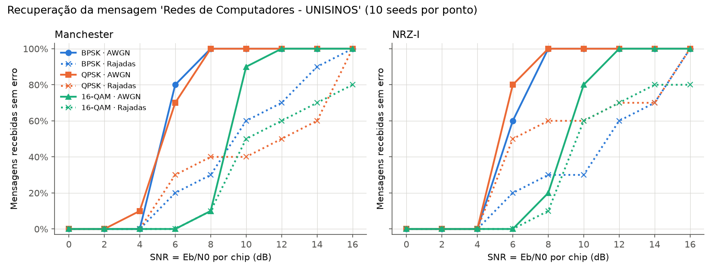

# Simulador de Transmissão Digital

Este é o Trabalho II de Redes de Computadores (UNISINOS), feito em dupla por **Gabriel Maalouf** e **Pedro Schmidt**.

A ideia do trabalho foi montar, em Python, um simulador de transmissão digital do começo ao fim. Uma mensagem em ASCII vira bits, passa por uma **codificação de linha**, é **modulada** e atravessa um **canal ruidoso**. Do outro lado, ela é demodulada e decodificada, e a gente compara o que chegou com o que foi enviado. Assim conseguimos medir a **taxa de erro de bits (BER)** e a **eficiência espectral** de cada combinação de técnicas, e ver como o ruído (principalmente o ruído em rajadas) bagunça o resultado.

O que a gente implementou:

- **2 codificações de linha:** Manchester e NRZ-I.
- **3 modulações:** BPSK, QPSK e 16-QAM (a de ordem superior), todas com mapeamento Gray.
- **2 cenários de canal:** AWGN com SNR controlada e ruído em rajadas (cadeia de Markov de 2 estados).
- **Plano experimental:** 1.080 ensaios (9 SNRs, 10 repetições, 100.000 bits cada). Dele saem gráficos de BER × SNR com intervalo de confiança, uma tabela de compromisso BER × eficiência, um teste de consistência, as constelações antes e depois do canal e a comparação com a teoria.

## 1. Como instalar e executar

Você vai precisar de Python 3. A gente desenvolveu e testou com Python 3.14, no Windows.

```bash
git clone https://github.com/GabrielMaalouf/projeto-redes-modulacao.git
cd projeto-redes-modulacao

python -m venv venv
source venv/Scripts/activate      # Windows (Git Bash). No Windows PowerShell: venv\Scripts\Activate.ps1
# source venv/bin/activate        # Linux ou macOS

pip install -r requirements.txt
python main.py tudo               # roda tudo e regera os resultados (cerca de 1 minuto)
```

As dependências são `numpy`, `matplotlib`, `scipy` e `pytest`. O programa roda pela linha de comando, sem interface gráfica. Se preferir, dá para rodar cada etapa separadamente:

| Comando | O que faz | Onde sai |
|---|---|---|
| `python main.py consistencia` | teste de consistência (canal ideal e SNR de 40 dB) | `results/consistencia.txt` |
| `python main.py demo` | passa uma mensagem ASCII pelo sistema e mostra os bits e as letras que chegaram erradas | terminal |
| `python main.py varredura` | varredura completa de BER (1.080 ensaios) | `results/raw/results.csv` e `results/raw/config.txt` |
| `python main.py mensagem` | recuperação da mensagem nos dois canais | `results/raw/mensagem.csv` |
| `python main.py graficos` | gráficos e tabelas a partir dos CSVs brutos | `results/figures/*.png` e `results/tabela_compromisso.md` |
| `python main.py tudo` | todos os passos acima, em ordem | todos os arquivos acima |
| `python -m pytest` | testes automáticos (91 testes) | terminal |

Uma dica: o comando `graficos` só lê os CSVs, então dá para refazer as figuras sem rodar a varredura inteira de novo.

## 2. Estrutura do repositório

```
main.py                 ponto de entrada (linha de comando)
requirements.txt        dependências
src/
  config.py             todos os parâmetros do experimento
  message.py            texto ASCII <-> bits e geração de bits aleatórios
  line_coding.py        Manchester e NRZ-I (codificação e decodificação)
  modulation.py         BPSK, QPSK e 16-QAM (modulação e demodulação)
  channel.py            canal AWGN e canal com rajadas
  metrics.py            BER, posições dos erros, eficiência espectral
  simulator.py          cadeia completa, de ponta a ponta
  theory.py             curvas teóricas de BER em AWGN
  experiments.py        varredura, recuperação da mensagem, consistência e demonstração
  plots.py              agregação dos resultados, gráficos e tabela de compromisso
tests/                  testes automáticos (um arquivo por módulo)
results/
  raw/                  resultados brutos em CSV e configuração usada
  figures/              gráficos gerados
  consistencia.txt      saída do teste de consistência
  tabela_compromisso.*  tabela BER × eficiência espectral (md e csv)
video/                  vídeo de demonstração
```

## 3. Como o simulador funciona

```
mensagem ──► codificação ──► modulação ──► CANAL ──► demodulação ──► decodificação ──► bits ──► métricas
ASCII/bits    de linha       (símbolos)   (ruído)     (decisão)       de linha        recebidos   (BER)
message.py   line_coding.py  modulation.py channel.py  modulation.py  line_coding.py  simulator.py metrics.py
```

Cada etapa ficou em um módulo separado, e o `simulator.py` só "liga os fios" entre eles (na função `transmitir`). Isso ajudou bastante a testar cada parte isoladamente. Entre as etapas, circulam sempre três tipos de dado: **bits** (0 e 1), **chips** (a saída da codificação de linha, também 0 e 1) e **símbolos** (números complexos com energia média 1).

O que cada módulo faz, resumidamente:

- **message.py:** transforma cada caractere em 8 bits pela tabela ASCII e faz o caminho inverso. Também gera bits aleatórios a partir de uma seed, que é o que usamos nas varreduras.
- **line_coding.py:** no Manchester, cada bit vira 2 chips (0 → `10` e 1 → `01`). No NRZ-I, cada bit vira 1 chip: o bit 1 inverte o nível e o bit 0 mantém. O Manchester ainda devolve as posições dos pares inválidos (`00` ou `11`), que são erros detectados.
- **modulation.py:** BPSK (1 bit por símbolo), QPSK (2) e 16-QAM (4). Em todas o mapeamento é Gray e a energia média é 1. A demodulação é por decisão direta: cada eixo é decidido pelo sinal ou pelos limiares do 16-QAM. Quando o número de bits não é múltiplo de bits por símbolo, completamos com zeros e o receptor corta o excesso.
- **channel.py:** AWGN e rajadas. Os detalhes estão na seção 5.
- **metrics.py:** BER, posições dos bits incorretos, letras erradas e eficiência espectral nominal.
- **theory.py:** BER teórica em AWGN, para comparar com a simulação.

## 4. Parâmetros do experimento

Todos ficam em `src/config.py`, e a configuração usada em cada execução é salva em `results/raw/config.txt`.

| Parâmetro | Valor |
|---|---|
| Modulações | BPSK (1 bit/símbolo), QPSK (2) e 16-QAM (4) |
| Codificações de linha | Manchester e NRZ-I |
| Canais | AWGN e rajadas |
| Rajadas | P(bom → ruim) = 0,01; P(ruim → bom) = 0,1; no estado ruim, SNR 10 dB menor |
| SNR (Eb/N0 por chip) | 0, 2, 4, 6, 8, 10, 12, 14 e 16 dB (9 valores) |
| Bits de informação por ensaio | 100.000 |
| Repetições (seeds) | 10 (seeds 1 a 10), ou seja, 1.000.000 de bits por ponto dos gráficos |
| Total de ensaios | 2 canais × 3 modulações × 2 codificações × 9 SNRs × 10 seeds = **1.080** |
| Mensagem de demonstração | `"Redes de Computadores - UNISINOS"` (256 bits) |

## 5. Decisões de modelagem

Algumas escolhas mudam bastante a leitura dos resultados, então vale explicá-las.

**Definição de SNR.** Usamos Eb/N0 **por chip transmitido**, isto é, a energia de cada bit que entra no modulador. Como os símbolos têm energia média 1, temos Es/N0 = Eb/N0 · (bits por símbolo), e o ruído tem variância 1/(2·Es/N0) em cada eixo (I e Q). Um detalhe importante: o Manchester manda 2 chips para cada bit de informação. Na mesma SNR por chip, ele gasta o dobro de energia por bit de informação (+3 dB) em relação ao NRZ-I. Convém ter isso em mente ao comparar as duas codificações.

**Canal AWGN.** Soma ruído gaussiano complexo, com a mesma variância, em todos os símbolos.

**Canal com rajadas.** O canal alterna entre um estado *bom* (ruído do AWGN) e um estado *ruim* (SNR 10 dB menor). A cada símbolo, há 1% de chance de passar de bom para ruim e 10% de voltar. Na média, isso deixa 0,01/(0,01 + 0,1) ≈ 9% dos símbolos no estado ruim, em blocos de cerca de 10 símbolos seguidos. Os erros ficam agrupados, como numa interferência que liga e desliga.

**Comparação justa.** Para cada seed, os **mesmos bits** são usados em todas as modulações, codificações, canais e SNRs. O ruído usa a seed `seed + 100000`, para não sair da mesma sequência dos bits. No canal com rajadas, o ruído base é o mesmo do AWGN (mesma seed) e só é amplificado no estado ruim. Assim, a diferença entre os dois canais vem apenas da degradação.

**Tamanho da amostra.** Com 10⁶ bits por ponto, uma BER de 10⁻⁴ gera cerca de 100 erros (erro relativo de aproximadamente 1/√100 = 10%). A menor BER mensurável fica em torno de 10⁻⁶. Quando não há nenhum erro, o ponto é desenhado sobre a linha pontilhada do piso (10⁻⁶), e isso quer dizer "BER < 10⁻⁶", não "BER = 10⁻⁶".

**Variabilidade.** As barras de erro dos gráficos são o intervalo de confiança de 95% da BER média entre as 10 seeds (t de Student, 9 graus de liberdade). Os valores de cada seed estão em `results/raw/results.csv`, e o resumo (média, desvio, IC95%, mínimo e máximo) está em `results/raw/ber_resumo.csv`.

**Eficiência espectral nominal.** Calculamos como bits por símbolo ÷ chips por bit, supondo 1 símbolo por segundo por Hz. BPSK, QPSK e 16-QAM com NRZ-I dão 1, 2 e 4 bits/s/Hz. Com Manchester, a eficiência cai pela metade: 0,5, 1 e 2.

## 6. Codificação de linha × correção de erros

São duas coisas diferentes, e é fácil confundir:

- **Codificação de linha** define *como* os bits viram níveis e transições do sinal. Ela garante sincronismo (transições frequentes) e controla o nível DC. **Não adiciona redundância para corrigir erros.** O Manchester até *detecta* alguns erros (um par `00` ou `11` é inválido), mas não sabe qual dos dois chips está certo e decide pelo primeiro. O erro continua lá, e a BER do bit fica igual à BER do chip.
- **Codificação de correção de erros (FEC)**, como Hamming, Reed-Solomon ou convolucional, **acrescenta bits de redundância** calculados a partir dos dados. Com eles, o receptor consegue detectar *e corrigir* bits errados.

Neste trabalho usamos só codificação de linha. Nenhum erro é corrigido, apenas medido.

## 7. Resultados e análise

### 7.1 BER × SNR em AWGN (simulado e teórico)


A simulação (marcadores com barra de IC95%) acompanha a teoria (tracejado) em todas as combinações, e isso é verificado automaticamente em `tests/test_simulator.py`. O que observamos:

- **BPSK e QPSK têm a mesma BER por chip.** O QPSK equivale a dois BPSK independentes em quadratura (um em cada eixo), com a mesma energia por bit. Com o mesmo desempenho, ele dobra a eficiência.
- **O 16-QAM precisa de cerca de 4 dB a mais** para a mesma BER (por exemplo, para BER ≤ 10⁻³ com NRZ-I: 11,0 dB contra 7,2 dB do QPSK), porque os pontos ficam mais próximos entre si.
- **O NRZ-I dobra a BER** (≈ 2p(1 − p), em que p é a BER de chip). A decodificação é diferencial, então um chip errado atrapalha dois bits.
- **Manchester com 16-QAM (um achado do experimento).** O Manchester só gera pares complementares (`10` ou `01`), então cada eixo do 16-QAM recebe (bit de sinal, bit de módulo) = (c, 1 − c). Só os níveis −1 e +3 são usados, ou seja, **apenas 4 dos 16 pontos** da constelação (veja `results/figures/constelacoes_manchester.png`). A constelação deixa de ser simétrica e o bit decodificado passa a depender só do bit de sinal. Em SNR alta, a BER fica em torno de 2/3 da fórmula clássica do 16-QAM. O modelo teórico desse caso está em `src/theory.py`. Pelo mesmo motivo, o QPSK com Manchester usa só 2 pontos (equivale a um BPSK na diagonal).

Outros gráficos: `results/figures/ber_snr_rajadas.png` (BER × SNR no canal com rajadas) e `results/figures/ber_snr_comparativo.png` (todas as combinações em AWGN juntas).

### 7.2 AWGN × ruído em rajadas


Com rajadas, a BER deixa de cair rápido conforme a SNR sobe. O canal passa cerca de 9% do tempo no estado ruim, então, em SNR alta, quase todos os erros vêm desses símbolos e a BER fica dominada por eles. Dois exemplos da tabela de resultados:

- BPSK com Manchester a 8 dB: BER de 1,8·10⁻⁴ em AWGN contra 1,2·10⁻² com rajadas, mais de 60 vezes maior.
- BPSK com Manchester a 12 dB: menor que 10⁻⁶ em AWGN contra 3,4·10⁻³ com rajadas.

Ou seja, aumentar a potência ajuda pouco nesse cenário. Além disso, os erros aparecem **agrupados**, e muitos bits seguidos se perdem de uma vez. Esse é justamente o caso em que FEC com entrelaçamento (*interleaving*) ou retransmissão faria diferença.

### 7.3 Recuperação da mensagem



O gráfico mostra em que fração das 10 repetições a mensagem inteira (256 bits) chegou sem nenhum erro. Em AWGN, isso acontece em 100% das repetições a partir de cerca de 8 dB (BPSK e QPSK) e 12 dB (16-QAM). Com rajadas, mesmo em 14 a 16 dB algumas repetições ainda chegam corrompidas, porque basta uma rajada cair em cima da mensagem. Moral da história: uma BER média baixa não garante que a mensagem chegue inteira.

### 7.4 Tabela de compromisso BER × eficiência espectral

A tabela completa (BER em 4, 8 e 12 dB nos dois canais) está em [`results/tabela_compromisso.md`](results/tabela_compromisso.md). Um resumo:

| Modulação | Codificação | Eficiência (bits/s/Hz) | BER AWGN @8 dB | SNR p/ BER ≤ 10⁻³ (AWGN) | SNR p/ BER ≤ 10⁻³ (rajadas) |
|---|---|---|---|---|---|
| 16-QAM | NRZ-I | 4,0 | 1,85·10⁻² | 11,0 dB | > 16 dB |
| QPSK | NRZ-I | 2,0 | 3,78·10⁻⁴ | 7,2 dB | 15,0 dB |
| 16-QAM | Manchester | 2,0 | 6,21·10⁻³ | 10,1 dB | > 16 dB |
| BPSK | NRZ-I | 1,0 | 3,76·10⁻⁴ | 7,2 dB | 15,0 dB |
| QPSK | Manchester | 1,0 | 1,99·10⁻⁴ | 6,7 dB | 14,2 dB |
| BPSK | Manchester | 0,5 | 1,77·10⁻⁴ | 6,7 dB | 14,2 dB |

**Quando cada uma faz mais sentido:**

- **16-QAM:** tem a maior eficiência (4 bits/s/Hz com NRZ-I). Serve para enlaces com **SNR alta e estável** (acima de uns 11 dB em AWGN) e banda escassa. Em compensação, é a mais sensível ao ruído e às rajadas. Com Manchester, a eficiência nominal (2 bits/s/Hz) engana: como só 4 pontos são usados, ela perde para o QPSK com NRZ-I, que tem a mesma eficiência e uma BER muito menor (3,8·10⁻⁴ contra 6,2·10⁻³ em 8 dB).
- **QPSK:** tem a mesma BER por chip que o BPSK, com o dobro da eficiência. É o melhor compromisso na faixa intermediária de SNR e supera o BPSK sempre que a banda importa.
- **BPSK:** é a mais robusta por símbolo e a mais simples de demodular. Só compensa quando sobra banda ou quando o receptor precisa ser bem simples.
- **Manchester × NRZ-I:** na mesma SNR por chip, o Manchester tem BER cerca de 2 vezes menor, mas usa o dobro de banda e o dobro de energia por bit de informação, e a eficiência cai pela metade. O NRZ-I preserva a banda, mas propaga erros. O Manchester traz também sincronismo e detecção de pares inválidos.
- **Canal com rajadas:** nenhuma combinação atinge BER baixa só aumentando a SNR (em 16 dB, só BPSK e QPSK chegam a 10⁻³). Nesse cenário, é preciso FEC com entrelaçamento ou retransmissão.

### 7.5 Constelações antes e depois do canal

Estão em `results/figures/constelacoes_nrzi.png` e `results/figures/constelacoes_manchester.png`, com SNR de 8 dB. Cada figura tem três colunas: símbolos transmitidos, após AWGN e após rajadas. Na terceira, os símbolos do estado ruim aparecem em cinza, o que deixa fácil ver como eles se espalham.

## 8. Teste de consistência

O comando `python main.py consistencia` transmite a mensagem por **todas** as combinações de modulação e codificação, em canal **ideal** (sem ruído) e com **SNR de 40 dB** em AWGN e em rajadas. Em todos os casos a mensagem é recuperada **sem nenhum erro** (o resultado fica em `results/consistencia.txt`). O teste também envia 253 bits (que não é múltiplo de 2 nem de 4) para validar o preenchimento com zeros do QPSK e do 16-QAM. O receptor corta os bits extras, e o tamanho recebido é igual ao enviado.

Divergências que poderiam aparecer, e por que acontecem:

- **Preenchimento (padding):** sem o corte no receptor (`[:len(bits)]` em `simulator.py`), voltariam bits a mais.
- **NRZ-I:** um único chip errado gera 2 bits errados (o atual e o seguinte), por causa da decodificação diferencial.
- **Manchester:** pares inválidos (`00` ou `11`) são contados como erros detectados e decididos pelo primeiro chip.
- **Caracteres não imprimíveis:** um byte corrompido fora da faixa ASCII imprimível aparece como `?`.

## 9. Validação

- **Testes automáticos:** são 91 testes (`python -m pytest`), com pelo menos um arquivo por módulo. Eles verificam coisas como: ida e volta de cada codificação e modulação, energia média igual a 1, variância do ruído medida contra a calculada, proporção de símbolos ruins nas rajadas, reprodutibilidade por seed e recuperação da mensagem em canal ideal em todas as combinações.
- **Comparação com a teoria:** BPSK e QPSK seguem BER = ½ · erfc(√(Eb/N0)), e o 16-QAM com Gray segue a aproximação (3/8) · erfc(√(0,4 · Eb/N0)). Para o NRZ-I, a BER é 2p(1 − p), e para o Manchester com 16-QAM usamos o modelo específico descrito na seção 7.1. Nas simulações com 400 mil bits (4 seeds), a razão entre BER simulada e teórica ficou entre 0,98 e 1,10 em 4 e 8 dB para as 6 combinações.

## 10. Limitações

Vale deixar claro o que o simulador **não** faz:

- A SNR é definida **por chip**, então Manchester e NRZ-I não pagam o mesmo preço de energia por bit de informação (diferença de 3 dB).
- A demodulação é por decisão direta (*hard decision*), sem decisão suave.
- Supomos sincronismo perfeito e símbolos já em banda base equivalente, sem filtragem de pulso, desvanecimento nem multipercurso.
- A eficiência espectral é nominal e não considera a largura de banda real do sinal.
- O modelo de rajadas tem só 2 estados, e os parâmetros (1%, 10%, −10 dB) foram escolhidos por nós para deixar o efeito visível.
- Para cada seed, a mesma realização de ruído é escalada em todas as SNRs, então os pontos de uma curva não são totalmente independentes entre si. Quem dá a variabilidade estatística são as 10 seeds distintas.

## 11. Reprodutibilidade

Tudo é determinístico, com seeds fixas. O comando `python main.py tudo` gera os mesmos CSVs, figuras e tabelas (testamos em uma cópia limpa do repositório e os CSVs saíram idênticos). Os parâmetros usados ficam em `results/raw/config.txt`. Os resultados brutos, um ensaio por linha, estão em `results/raw/results.csv`, e todos os gráficos são gerados a partir deles pelo comando `python main.py graficos`.

## 12. Quem fez o quê

| Integrante | O que fez |
|---|---|
| Gabriel Maalouf | `message.py`, `line_coding.py`, `modulation.py`, `channel.py`, `metrics.py`, `config.py` e os testes desses módulos; slides da parte de dados, codificação, modulação e canal |
| Pedro Schmidt | `simulator.py`, `theory.py`, `experiments.py`, `plots.py`, `main.py` e testes do simulador; análise dos resultados, vídeo e slides da parte de resultados |

O README foi escrito em conjunto, e os dois participam da apresentação oral.

## 13. Vídeo

Vídeo de demonstração (até 5 minutos): **COLAR AQUI O LINK** ou arquivo em `video/`.

## Referências

- Proakis, J. G.; Salehi, M. *Digital Communications*. McGraw-Hill.
- Haykin, S. *Communication Systems*. Wiley.
- Enunciado do Trabalho II, Redes de Computadores, UNISINOS (2026/2).
